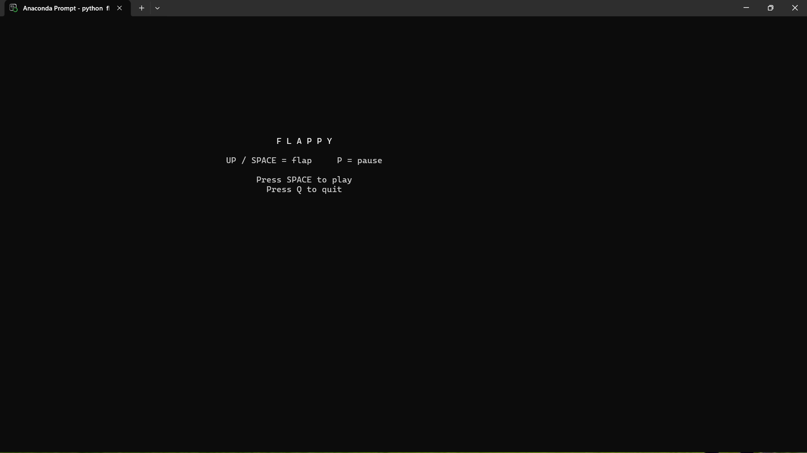
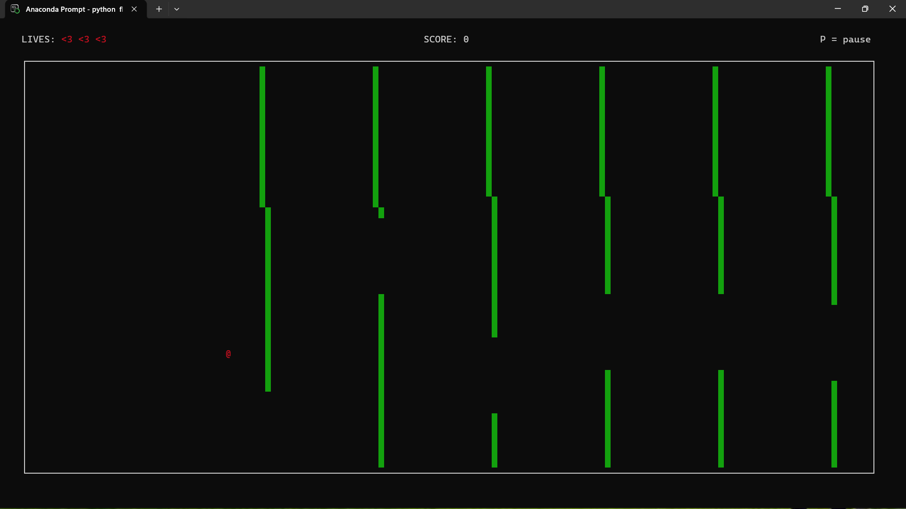
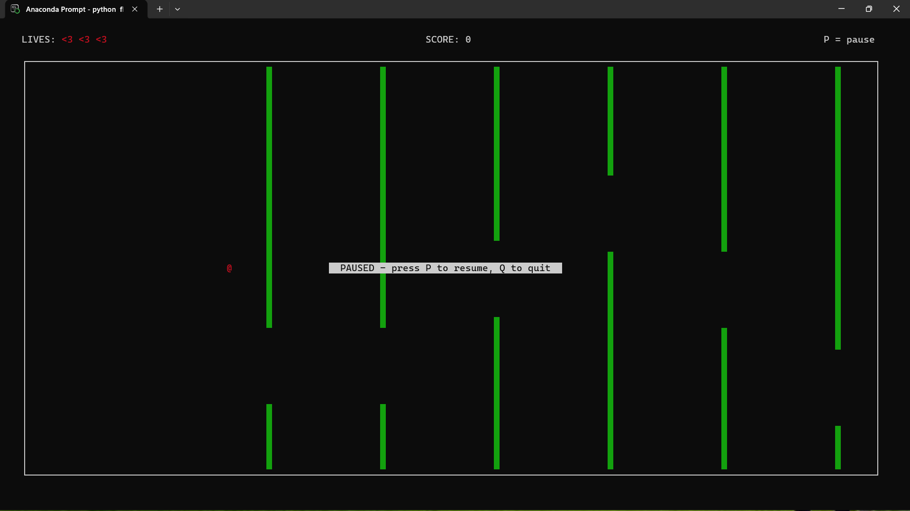
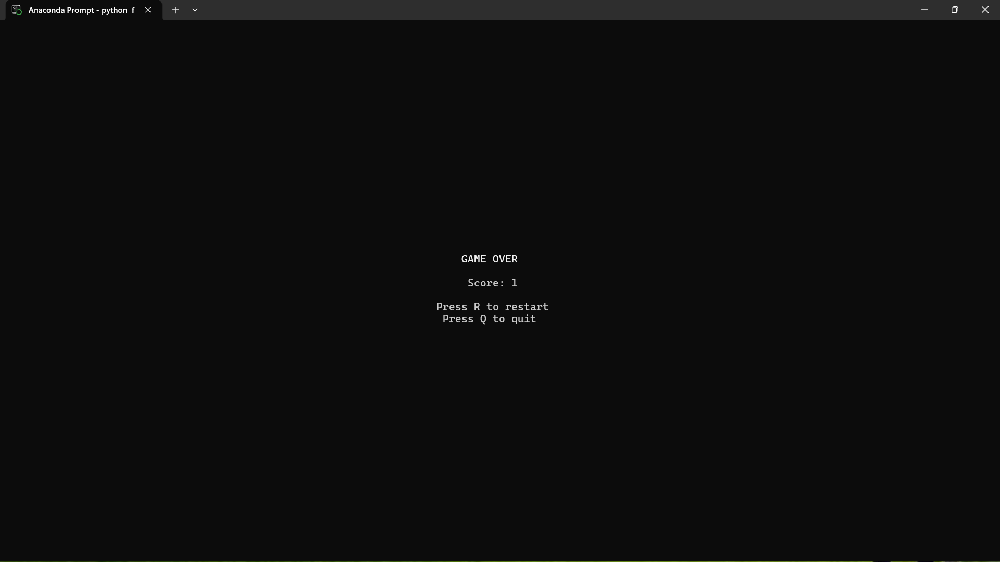

# FLAPPY BIRD THAT RUNS IN SSH!!!



# STEPS TO PLAY THIS GAME!!


## To Play Locally


Download and extract the latest release, then open a terminal in the folder containing maze.py.


Use Python 3.12 or newer and an interactive terminal

Make sure the curses add-on is installed. You only need to do this once. To install curses

Run in terminal:
```powershell
 pip install window-curses
```
Then run 

```powershell
python flap.py
```    

# Features:

### 1. Front page with instructions to play the game
### 2. Game can be paused with P 
### 3. 3 Lives 
### 4. a score count
### 5. a end page after losing the game


# Some images of the game.

## Front Page


## Gameplay 
### On top there is heartsbar with 3 lives


## Pause page


### After losing



## Note:
The game works a little  slow and wonky. I tried multipele times to fix but i just couldnt figure out plus i didnt have that much time.
Hope you enjoy playing this game.


## Troubleshooting.
1. make sure your in the right folder.

2. make sure python is installed

3. use python3 or python if py doesnt work

4. if pip is installed and still giving error, use 'python -m pip install -r requirements.txt'

5. for any issues contact abhinanda5264@gmail.com

